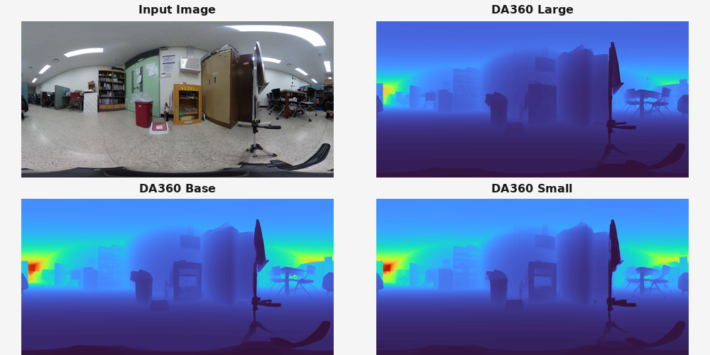
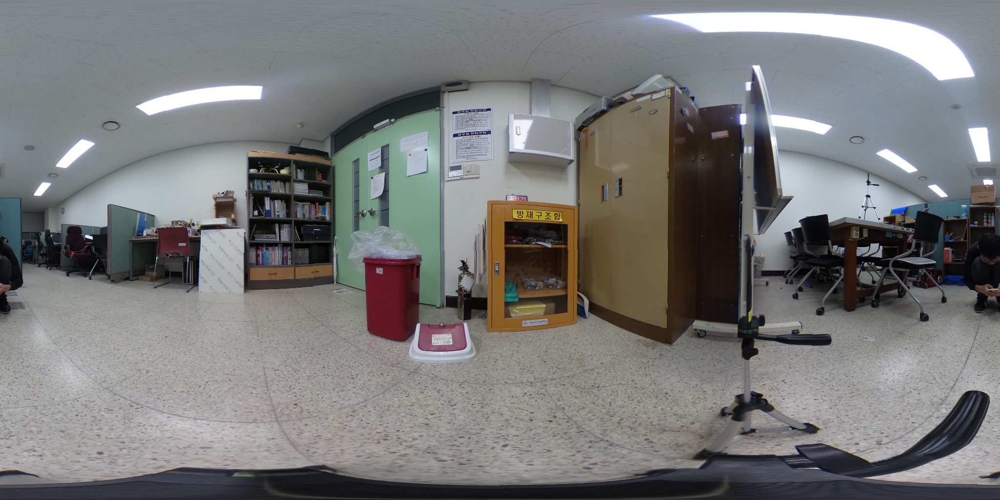
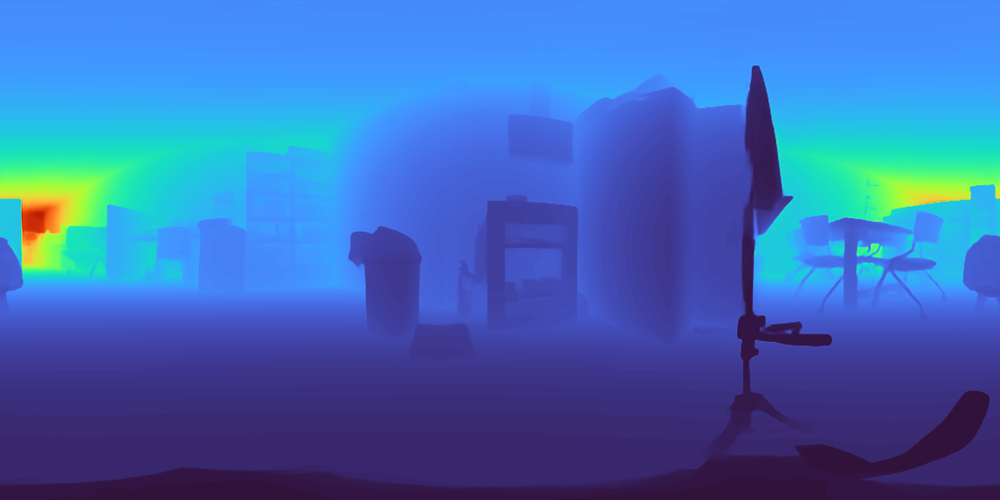
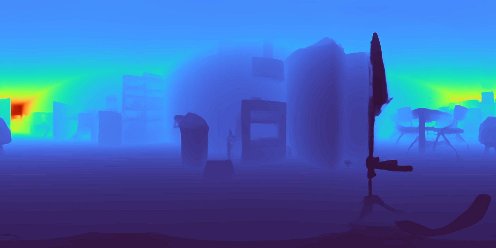

# DA360_inference
An unofficial inference-only implementation of DA360 for 360° equirectangular depth estimation



## Checkpoints

Download checkpoints [here](https://huggingface.co/hljiang/DA360).  
Place the downloaded checkpoints in the `checkpoints/` directory.

```text
checkpoints/
├── DA360_base.pth
├── DA360_large.pth
├── DA360_small.pth
└── checkpoints_here.txt
```

## input data

Place the input file in the `input/` directory.

```text
input/
├── input.jpg
└── input_here.txt
```

## Setup

This project uses [uv](https://docs.astral.sh/uv/).

```bash
uv sync
```

## Run

```bash
uv run inference.py
```

## Results

<details>
<summary>Input image</summary>



</details>

<details>
<summary>DA360 Large depth visualized</summary>


</details>

<details>
<summary>DA360 Base depth visualized</summary>



</details>

<details>
<summary>DA360 Small depth visualized</summary>



</details>
